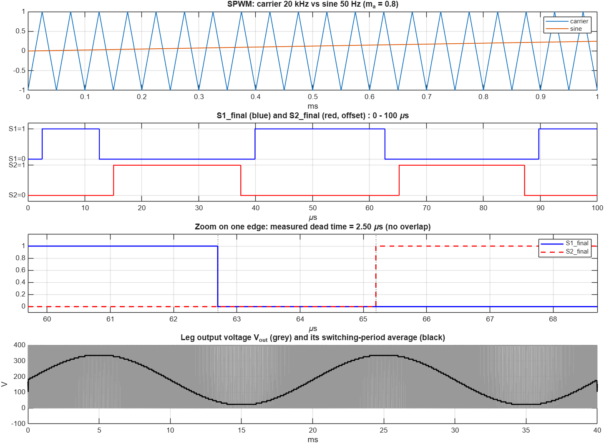
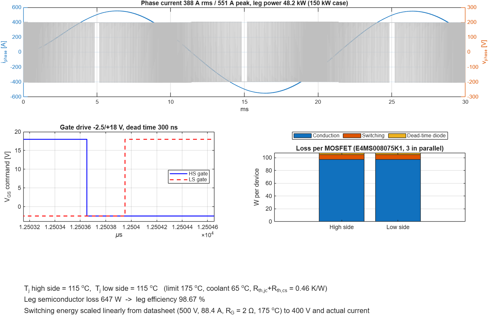
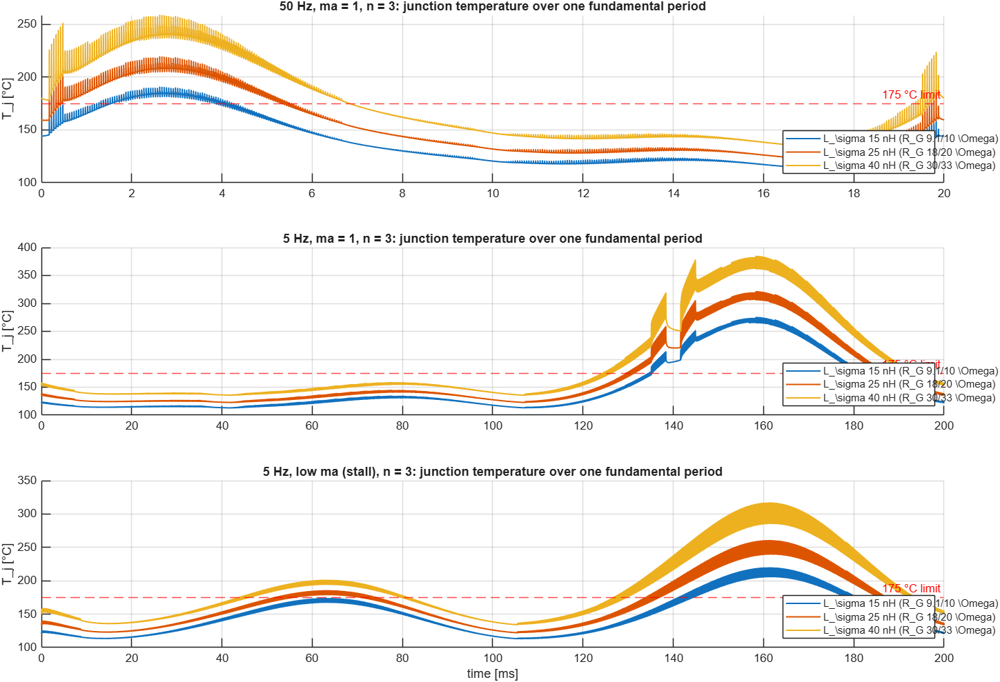

# EV Inverter Single-Leg PCB Design & Simulation

Design and simulation of a single inverter leg for an electric vehicle (EV) traction drive, covering both the power-stage PCB layout in Altium Designer and switching/thermal analysis in MATLAB/Simulink.

---

## Overview

This project implements **one leg of a three-phase EV inverter** rated for approximately **150 kW per leg (48.2 kW per phase)**. The design targets a **400 V DC bus** with a phase current of **388 A rms / 551 A peak**, using SiC MOSFETs in a parallel configuration.

### Key Specifications

| Parameter | Value |
|---|---|
| DC bus voltage | 400 V |
| Phase current | 388 A rms / 551 A peak |
| Leg power | 48.2 kW (150 kW system) |
| Switching frequency | 20 kHz |
| MOSFET | E4MS008075K1 (SiC, 3 in parallel per switch) |
| Gate drive voltage | -2.5 V / +18 V |
| Dead time | 300 ns (designed), 2.5 us (SPWM model) |
| Coolant temperature | 65 C |
| Leg efficiency | 98.67% |

---

## Repository Structure

```
.
├── PCB/                                        # Altium Designer project files
│   ├── BYD_Leg_OneLeg.PrjPcb                  # Altium project file
│   ├── BYD_Leg_OneLeg.SchDoc                   # Schematic document
│   ├── BYD_Leg_OneLeg.PcbDoc                   # PCB layout document
│   ├── Design Rule Check - BYD_Leg_OneLeg.drc  # DRC report
│   ├── SamacSys.SchLib                         # Component schematic library
│   └── SamacSys.PcbLib                         # Component footprint library
│
└── simulink/                                    # MATLAB/Simulink simulation files
    ├── ev_inverter_oneleg.slx                   # Full inverter leg model (final)
    ├── ev_inverter_oneleg_before_deadtime.slx   # Model before dead-time insertion
    ├── ev_inverter_oneleg_before_step4.slx      # Model before loss/thermal analysis
    ├── deadtime_results.png                     # SPWM & dead-time verification plots
    ├── step4_results.png                        # Loss breakdown & thermal results
    └── worst_case_results.png                   # Worst-case junction temperature analysis
```

---

## PCB Design

The PCB is designed in **Altium Designer** and includes:

- **Power MOSFETs**: 10x E4MS008075K1 SiC MOSFETs (high-side and low-side switches, 3 in parallel per position with spares)
- **Gate drivers**: Dedicated gate drive ICs (U1, U2) with -2.5 V / +18 V output
- **DC bus connectors**: High-current connectors (J1-J6) for DCP, DCN, and phase output (PH)
- **Decoupling**: DC bus capacitors (C16-C19, large film/electrolytic) and local ceramic bypass capacitors
- **Component libraries**: SamacSys libraries for schematic symbols and PCB footprints

### Design Rules

- **Power net clearance**: 100 mil (DCP, DCN, PH nets)
- **General clearance**: 10 mil
- **Fine-pitch IC clearance**: 7 mil (gate driver ICs)
- **Trace width**: 10 mil min, 100 mil max

### DRC Status

The design rule check reports **204 violations**, primarily:
- Silk-to-solder-mask clearance (cosmetic, non-functional)
- Solder mask sliver warnings near vias
- Component height violations (tall capacitors and MOSFETs exceeding board-level constraint — expected for power components)
- 6 hole-size violations on high-current connectors (large drill exceeding default max — intentional)

> **Note**: Most violations are cosmetic or involve intentional design choices for power components and do not affect electrical functionality.

---

## Simulink Simulation

The simulation is built in progressive steps:

### Step 1-3: SPWM Generation & Dead-Time Insertion

- **Carrier**: 20 kHz triangular wave
- **Modulating signal**: 50 Hz sine, modulation index m_a = 0.8
- **Dead time**: 2.5 us inserted between complementary gate signals
- **Verification**: No overlap between S1 and S2 gate signals confirmed

### Step 4: Loss & Thermal Analysis

- **Conduction losses**: Dominant loss mechanism (~95 W per device)
- **Switching losses**: Scaled linearly from datasheet (500 V, 88.4 A, R_G = 2 ohm, 175 C) to 400 V operating conditions
- **Dead-time diode losses**: Minor contribution
- **Total semiconductor loss per leg**: 647 W
- **Junction temperature**: T_j = 115 C (high-side and low-side), well within the 175 C limit
- **Thermal resistance**: R_th,jc + R_th,cs = 0.46 K/W

### Worst-Case Thermal Analysis

Junction temperature sweep across three operating conditions with varying stray inductance (L_sigma) and gate resistance (R_G):

| Condition | L_sigma = 15 nH (R_G 9.1/10 ohm) | L_sigma = 25 nH (R_G 18/20 ohm) | L_sigma = 40 nH (R_G 30/33 ohm) |
|---|---|---|---|
| **50 Hz, m_a = 1** | ~180 C (marginal) | ~210 C (exceeds limit) | ~240 C (exceeds limit) |
| **5 Hz, m_a = 1** | ~250 C (exceeds limit) | ~300 C (exceeds limit) | ~375 C (exceeds limit) |
| **5 Hz, low m_a (stall)** | ~190 C (exceeds limit) | ~250 C (exceeds limit) | ~310 C (exceeds limit) |

> **Key finding**: Only the 50 Hz / lowest L_sigma configuration stays near the 175 C limit. Low-speed and stall conditions require derating or improved cooling.

---

## Simulation Results

### Dead-Time Verification


### Loss Breakdown & Thermal Results (150 kW Case)


### Worst-Case Junction Temperature Analysis


---

## Tools Used

- **Altium Designer** — Schematic capture and PCB layout
- **MATLAB/Simulink** — Inverter switching simulation, loss calculation, and thermal analysis
- **SamacSys** — Component library (schematic symbols + PCB footprints)

---

## Getting Started

### PCB Design
1. Open `PCB/BYD_Leg_OneLeg.PrjPcb` in Altium Designer
2. Ensure SamacSys libraries are linked (schematic and footprint libraries included in the project)

### Simulation
1. Open any `.slx` file in MATLAB/Simulink (R2023a or later recommended)
2. Run the model to reproduce the switching waveforms, loss calculations, and thermal analysis

---

## License

This project is for educational and research purposes.
